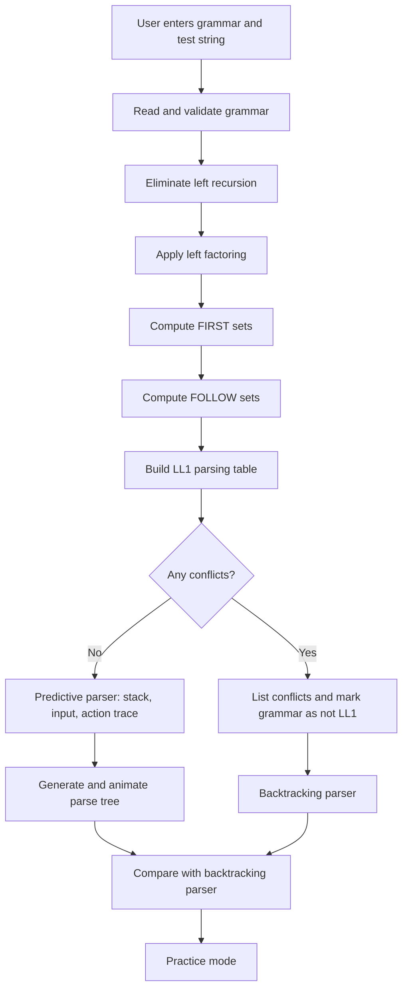
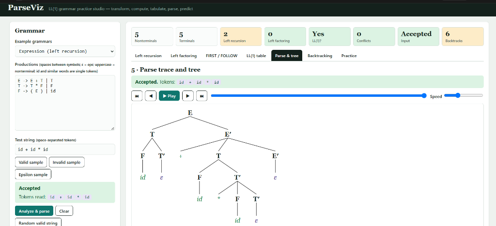
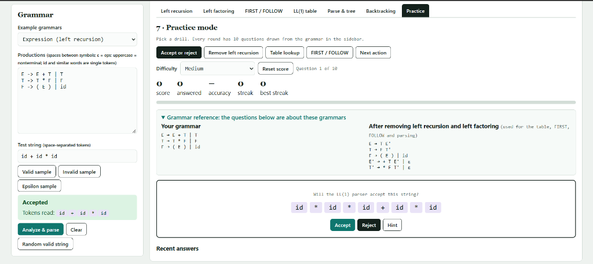
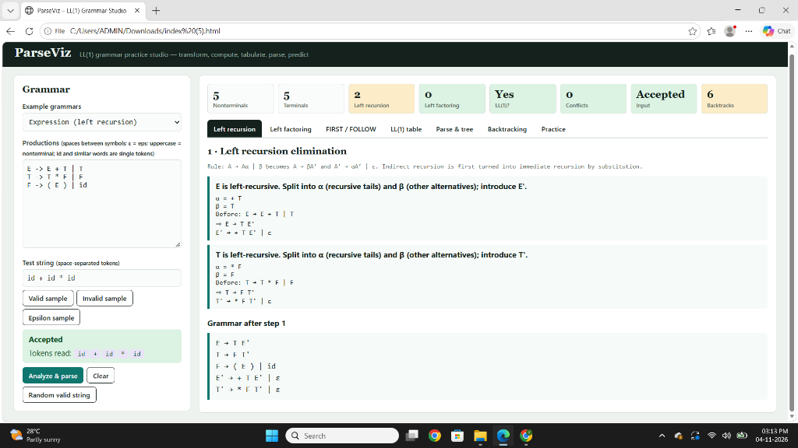
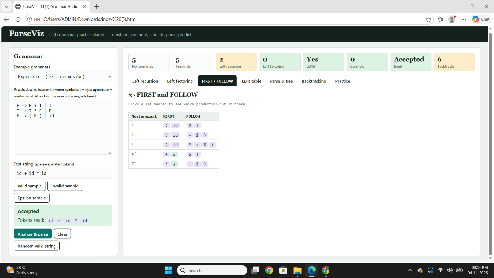
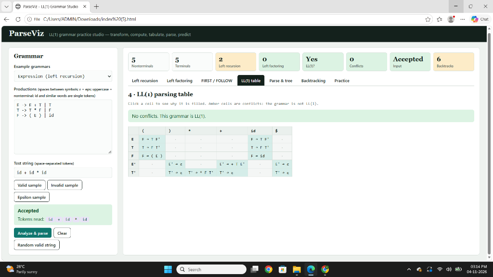

# ParseViz: Interactive LL(1) Grammar Practice Studio

ParseViz is a browser-based tool that makes top-down parsing visible, step by step. A student enters any context-free grammar and a test string. ParseViz then shows how the grammar is prepared for LL(1) parsing, how the FIRST and FOLLOW sets are computed, how the parsing table is built, how the input is parsed, and how the parse tree grows. A backtracking parser and a practice mode are included for comparison and revision.

Built for **PS-03: Compiler Design**

---

## Overview

Top-down parsing is usually taught on paper: students remove left recursion by hand, compute FIRST and FOLLOW sets, fill a table and trace a stack. Each step depends on the previous one, so one early mistake carries through the whole exercise, and the algorithm is hard to see in action.

ParseViz automates every stage and shows the intermediate result of each, so a learner can follow the full pipeline from the raw grammar to the finished parse tree. It runs entirely in the browser with no installation and no server.

## Problem Statement and Objectives

**Problem:** Build an interactive tool that demonstrates top-down parsing, covering grammar transformation, predictive table construction, parsing and tree generation.

**Objectives**

- Accept any context-free grammar and test string from the user.
- Remove left recursion and apply left factoring, showing every rewriting step.
- Compute FIRST and FOLLOW sets and explain where each member came from.
- Build the LL(1) parsing table and report conflicts when the grammar is not LL(1).
- Parse the input with a stack-based predictive parser and log every move.
- Draw the parse tree with animation controls.
- Provide a backtracking parser to compare against the predictive parser.
- Provide a practice mode so students can test their own understanding.

## Features

| Feature | What it does |
|---|---|
| Grammar and string input | Accepts any CFG; supports valid, invalid and epsilon test strings; random valid string generator; live analysis while typing |
| Left recursion elimination | Handles immediate and indirect left recursion and shows α, β and the rewritten rules for every step |
| Left factoring | Finds common prefixes and repeats until none remain |
| FIRST and FOLLOW | Fixed-point computation; click a member to see the production that added it |
| LL(1) parsing table | Filled, empty and conflict cells are highlighted; every conflict is listed |
| Parse trace | Shows the stack, remaining input and action taken at each step |
| Parse tree | Animated tree with play, step and speed controls; rejected strings show a red error node and message |
| Backtracking parser | Tries alternatives, undoes failed choices, compares step counts with the LL(1) parser and detects left-recursion loops |
| Practice mode | Five drills in rounds of 10 questions with score, streak and difficulty levels |

## Project Workflow

The tool follows the same order a student would follow on paper. The output of each stage feeds the next.



**Step by step**

1. **Input.** The user types a grammar and a test string, or loads one of the built-in sample grammars.
2. **Validation.** The grammar is read rule by rule. The start symbol, nonterminals and terminals are identified.
3. **Left recursion elimination.** Rules of the form `A → Aα | β` are rewritten so a top-down parser cannot loop forever.
4. **Left factoring.** Alternatives that share a prefix are split so the parser can decide with one lookahead symbol.
5. **FIRST and FOLLOW.** Both sets are computed to a fixed point, with the production responsible for each member recorded.
6. **LL(1) table.** Each production is placed in the table using the FIRST and FOLLOW sets. Two entries in one cell are reported as a conflict.
7. **Parsing.** A stack-based predictive parser consumes the input, and every step is logged.
8. **Parse tree.** Nodes are created as productions are applied. The tree can be played, stepped and sped up or slowed down.
9. **Backtracking comparison.** The same input is parsed by trying alternatives in order, so the two approaches can be compared.
10. **Practice.** The student tests their understanding with short question rounds.

## How Each Stage Works

### 1. Left recursion elimination
A rule such as `A → Aα | β` makes a top-down parser call itself endlessly. ParseViz rewrites it as `A → βA′` and `A′ → αA′ | ε`. For indirect recursion, earlier nonterminals are substituted first so the recursion becomes immediate, and then it is removed. Every step is displayed with its α and β parts.

### 2. Left factoring
When two alternatives of a nonterminal begin with the same symbols, the parser cannot choose between them with one lookahead token. ParseViz groups alternatives by their first symbol, moves the longest common prefix into a new nonterminal, and repeats until no common prefix remains.

### 3. FIRST and FOLLOW
- `FIRST(X)` is the set of terminals that can begin a string derived from `X`, plus `ε` if `X` can derive the empty string.
- `FOLLOW(A)` is the set of terminals that can appear immediately after `A` in some derivation. The end marker `$` is in the FOLLOW set of the start symbol.

Both are computed by repeating the rules until nothing changes. Clicking a member shows which production added it.

### 4. LL(1) parsing table
For each production `A → α`:
- put it in `M[A, t]` for every terminal `t` in `FIRST(α)`;
- if `α` can derive `ε`, also put it in `M[A, t]` for every `t` in `FOLLOW(A)`.

A cell with more than one production is a conflict, which means the grammar is not LL(1). Conflicts are highlighted and listed.

### 5. Predictive parsing and trace
The parser keeps a stack that starts with `$` and the start symbol. At each step it looks at the top of the stack and the current input symbol:
- terminal on top that matches the input: pop it and advance the input;
- nonterminal on top: look up the table, pop it and push the production's right side in reverse;
- no table entry or a mismatch: report a syntax error.

Each step shows the stack, the remaining input and the action taken.

### 6. Parse tree
Every production applied by the parser creates tree nodes. The tree is drawn as SVG and can be animated. When a string is rejected, a red error node and message mark the point of failure.

### 7. Backtracking parser
This is a recursive-descent parser that tries each alternative in order and undoes a choice when it fails. It works on grammars that are not LL(1), reports how many steps it needed compared with the LL(1) parser, and detects when left recursion would cause an infinite loop.

## Worked Example

Grammar entered by the user:

```
E -> E + T | T
T -> T * F | F
F -> ( E ) | id
```

**After left recursion elimination**

```
E  -> T E'
E' -> + T E' | ε
T  -> F T'
T' -> * F T' | ε
F  -> ( E ) | id
```

**FIRST and FOLLOW**

| Nonterminal | FIRST | FOLLOW |
|---|---|---|
| E | { (, id } | { $, ) } |
| E′ | { +, ε } | { $, ) } |
| T | { (, id } | { +, $, ) } |
| T′ | { *, ε } | { +, $, ) } |
| F | { (, id } | { *, +, $, ) } |

**LL(1) parsing table**

| | id | + | * | ( | ) | $ |
|---|---|---|---|---|---|---|
| E | E → T E′ | | | E → T E′ | | |
| E′ | | E′ → + T E′ | | | E′ → ε | E′ → ε |
| T | T → F T′ | | | T → F T′ | | |
| T′ | | T′ → ε | T′ → * F T′ | | T′ → ε | T′ → ε |
| F | F → id | | | F → ( E ) | | |

No cell has more than one entry, so the grammar is LL(1). The input `id + id * id` is accepted, and ParseViz shows the full trace and the tree.

## Grammar Notation

```
E -> E + T | T
T -> T * F | F
F -> ( E ) | id
```

- One rule per line.
- Use `->` or `→` between the two sides.
- Separate alternatives with `|`.
- Separate symbols with spaces. A word such as `id` is a single token.
- A symbol starting with a capital letter is a nonterminal. Everything else is a terminal.
- Write epsilon as `ε` or `eps`, or leave the alternative empty.
- The left side of the first rule is the start symbol.

## How to Run

1. Clone this repository or download it as a ZIP and extract it.
2. Open the file `index.html` in Chrome or Edge.

No installation, build step or internet connection is needed.

## Practice Mode

Practice mode turns the tool into a revision aid. It offers five drills in rounds of 10 questions, with a running score, a streak counter and difficulty levels, so students can check their own FIRST/FOLLOW sets, table entries and parsing steps against what ParseViz computes.

## Sample Grammars

The tool includes ready-made grammars for:

- Expression grammar (left recursion)
- Dangling else (LL(1) conflict)
- Epsilon productions
- Left factoring
- Indirect left recursion
- Balanced parentheses

## Algorithms

| Stage | Method |
|---|---|
| Left recursion | Split `A → Aα \| β` into `A → βA′` and `A′ → αA′ \| ε`; substitute earlier nonterminals first for indirect recursion |
| Left factoring | Group alternatives by first symbol, extract the longest common prefix into a new nonterminal, repeat |
| FIRST / FOLLOW | Fixed-point iteration, recording the production behind each member |
| LL(1) table | `A → α` goes in `M[A, t]` for `t` in FIRST(α), and for `t` in FOLLOW(A) if α derives ε; two entries in one cell is a conflict |
| Predictive parser | Stack, input pointer and table lookup; each step is logged and creates tree nodes |
| Backtracking parser | Recursive descent that tries alternatives in order and undoes failed choices |

## Repository Contents

```
index.html                               the complete application
Documentation/ParseViz_Documentation.docx   project documentation
PPT/ParseViz_Presentation.pptx              project presentation
Screenshots/                                output screens
README.md                                   this file
```

## Technology

HTML, CSS and plain JavaScript, with SVG for the parse tree. No external libraries.

---

## Output Screenshots

### Parse Tree & Trace


### Practice Mode


### Left Recursion Elimination


### FIRST & FOLLOW Sets


### LL(1) Parsing Table


---

*ParseViz — CD TEAM-09 | PS-03 | Compiler Design Hackathon*
